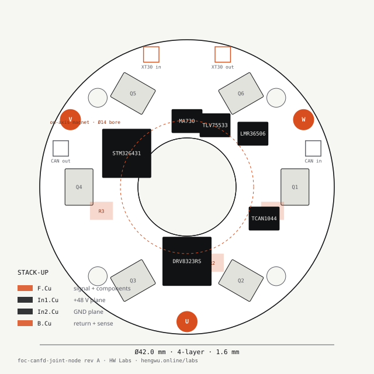

# foc-canfd-joint-node

A 42 mm, 48 V / 15 A brushless joint controller for humanoid and legged robots: STM32G431 +
DRV8323RS + six 1.45 mΩ MOSFETs, three Kelvin-sensed low-side shunts, an on-axis 14-bit magnetic
encoder, and CAN-FD for daisy-chained limbs.

Everything in this repository is the actual design input, not a description of one: the KiCad
schematic and four-layer board, a dual-source BOM, the FOC firmware, a CAN-FD wire codec, and the
verification suite that gates all of it.



## Specification

| Parameter | Value |
| :--- | :--- |
| Supply | 24–60 V DC (48 V nominal), reverse-polarity + surge protected (`D1` SMBJ58A) |
| Phase current | 15 A continuous with the board on a 5 mm aluminium spreader |
| Power stage | 6 × `BSC014N06NS` (60 V, 1.45 mΩ) in a 3-phase bridge |
| Gate driver | `DRV8323RS`, 3 integrated current-sense amplifiers, SPI-configurable |
| Current sense | 3 × 1 mΩ 2512 Kelvin shunts (`R1`–`R3`), low-side |
| Encoder | `MA730GQ`, 14-bit on-axis magnetic, SPI |
| Host bus | CAN-FD at 5 Mbit/s (`TCAN1044VDRQ1`), 2 × JST-GH 4-pin in/out |
| Logic | 3.3 V from `TLV75533`, 5 V from `LMR36506` (65 V input) |
| Board | 42.0 mm circle, 4 layers, 1.6 mm, Ø14 mm centre bore, 4 × M2.5 on a Ø36 mm bolt circle |
| Control rate | 20 kHz centre-aligned PWM, current loop in the TIM1 ISR |

## Power and signal chain

```
48 V ──┬── D1 SMBJ58A ──┬── Q1/Q3/Q5 (high side) ── U/V/W ── J1/J2 XT30 daisy chain
       │                │
       └── U5 LMR36506 ─┴── 5 V ── U6 TLV75533 ── 3.3 V ── U1 STM32G431
                                 │                        │
                                 └── U4 TCAN1044 ── CANH/CANL ── J3/J4 JST-GH
Q2/Q4/Q6 (low side) ── R1/R2/R3 (1 mΩ Kelvin) ── SOA/SOB/SOC ── U2 DRV8323RS
```

The sense resistors sit on the low side so the DRV8323RS amplifiers see a ground-referenced signal
without a high-voltage common mode. Each shunt has four pads: two carry the phase current, two tap the
inner edge of the element for the Kelvin connection.

## Firmware

`firmware/foc_control.c` — Clarke, Park, inverse Park, min-max-injection SVPWM with a circular
over-modulation limiter, two PI current regulators with clamping anti-windup, and the MIT Mini-Cheetah
impedance law:

```
tau = kp * (p_des - p) + kd * (v_des - v) + t_ff
iq_ref = clamp(tau * derate(temp) / Kt, ±15 A)
```

`derate()` is 1.0 up to 85 °C, falls linearly to 0 at 110 °C, and hard-cuts above that.

`firmware/canfd_codec.c` — two fixed-point frames, little-endian:

| Frame | ID | Length | Layout |
| :--- | :--- | :--- | :--- |
| MIT command | `0x100 + node` | 8 B | `p_des` i16 ×1 mrad · `v_des` i16 ×0.01 rad/s · `kp` u8 ×0.5 Nm/rad · `kd` u8 ×0.01 Nm·s/rad · `t_ff` i16 ×1 mNm |
| Joint status | `0x200 + node` | 12 B | `p` i16 · `v` i16 · `iq` i16 · `id` i16 (all ×0.01 in SI) · `vbus` u16 ×0.25 V · `temp` i8 °C · `fault` u8 bitfield |

Both directions saturate at the wire limits instead of wrapping, so a garbage frame can never command
a wrapped-around current.

## Verification

```bash
# the DFM gate this board is required to pass
python github_showcase/kicad-dfm-precheck/dfm_check.py \
    --min-annular 0.15 \
    github_showcase/foc-canfd-joint-node/hardware/foc_joint.kicad_pcb \
    github_showcase/foc-canfd-joint-node/hardware/foc_joint.kicad_sch
# -> 0 error(s), 0 warning(s), exit 0

# the suite: DFM, BOM↔schematic parity, geometry, SVG, transforms, SVPWM, PI, MIT law, CAN-FD
python -m unittest discover -s github_showcase/foc-canfd-joint-node/tests -v
```

The suite compiles both translation units with `-std=c99 -Wall -Wextra -Werror` when a C compiler is on
`PATH`, and skips that single test otherwise; the remaining 36 checks run with the standard library
alone.

What it actually asserts:

- `dfm_check.py` exits 0 at a **0.15 mm** annular-ring limit — no via, no pad, and no placeholder value
  is allowed to slip through;
- every BOM row has an LCSC code and a DigiKey alternate, and the designator set matches the schematic
  1:1 in both directions;
- the outline is Ø42.0 mm with a Ø14 mm bore, four mounting holes land on a Ø36 mm bolt circle, and the
  stack-up has exactly four copper layers;
- the SVG parses and carries the geometry it claims to;
- Clarke preserves amplitude, Park round-trips, SVPWM keeps `max + min = 1` inside the linear circle and
  clamps outside it, the MIT law is linear in position and velocity, derating crosses zero at 110 °C;
- the CAN-FD frames match the documented byte layout exactly, including saturation.

## Bill of materials

`hardware/BOM.csv` is one row per designator with manufacturer, MPN, a real LCSC `Cxxxxx` code, and a
DigiKey alternate MPN. The LCSC column is queried against JLCPCB's assembly library, so the codes are
the ones an assembler will actually match on.

## Known limitations (rev A)

- No brake chopper: regeneration into a full 48 V pack has to be absorbed by the supply or limited in
  firmware. Rev B is planned with a dump resistor and comparator.
- The DRV8323RS internal amplifiers are used; an external INA240 front end would give better common-mode
  rejection above 40 A.
- The CAN-FD termination resistor (`R9`, 120 Ω) is populated on both `J3` and `J4` in the current BOM
  layout; on a long daisy chain, fit it only at the two physical ends.
- Thermal numbers assume a spreader; free-air operation is limited by the FET case rise, not by the
  shunts.

## Licence

MIT — see `LICENSE`. Design files, firmware and tests are all covered by the same terms.

HW Labs / Hengwu Engineering — <https://hengwu.online/labs>
